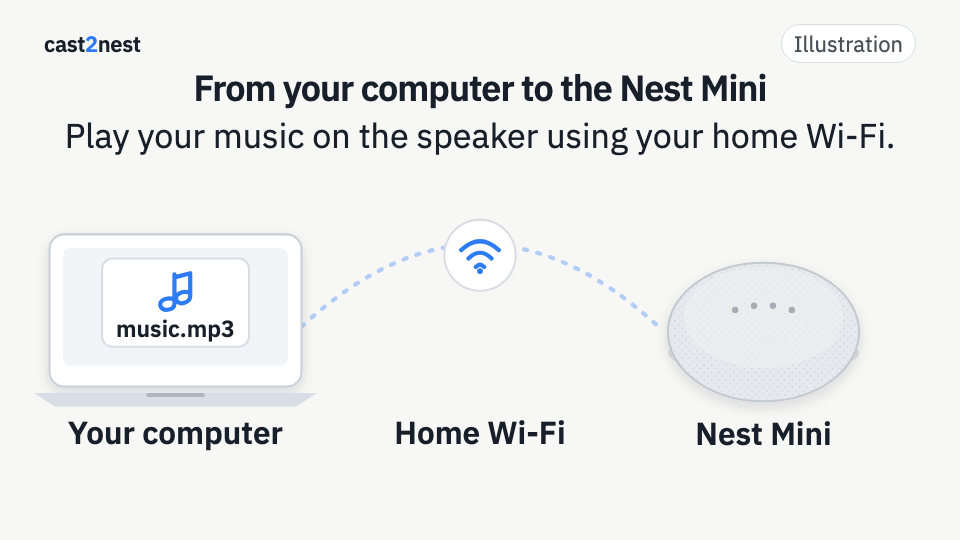

# cast2nest

Play audio from your computer on a Nest Mini or another compatible Google Cast
device. It works within your local network and does not require `pychromecast`.

**Local use:** your computer and the speaker must be connected to the same
trusted Wi-Fi network or LAN.



## What it does

- Plays MP3, FLAC, and WAV files without converting them.
- Converts other audio formats and saves a cached copy.
- Plays directories, M3U/M3U8 playlists, URLs, and standard input.
- Lets you check and change the volume, view status, and stop playback.
- Automatically discovers Cast devices on the local subnet.

## How it works

1. You select a song or another audio source on your computer.
2. `cast2nest` starts a local HTTP server for the files you are going to use.
3. The Cast device downloads that audio directly from your computer over the
   local network.

**Audio from local files is not uploaded to the Internet.** If you provide a
remote URL, the Cast device accesses that URL in the usual way.

The CastV2 protocol is implemented with the Python standard library. FFmpeg is
used only for metadata, conversion, and streaming from standard input.

## Requirements

- Python 3.10 or later.
- A Google Cast device on the same local network.
- FFmpeg and ffprobe for conversions, metadata, and standard input.
- For live streaming from standard input, FFmpeg with `libmp3lame`.

FFmpeg is not required to play MP3, FLAC, or WAV files directly.

### Installing FFmpeg

On macOS:

```sh
brew install ffmpeg
```

On Debian or Ubuntu:

```sh
sudo apt install ffmpeg
```

## Installation

```sh
git clone https://github.com/dantoac/cast2nest.git
cd cast2nest
./cast2nest.py --help
```

No Python packages need to be installed to use the program.

## Usage

### Play a song

```sh
./cast2nest.py play ~/Music/song.mp3
```

The process must stay open while the speaker plays local files. If HTTP port
8099 is in use, the program selects another one.

### Play multiple tracks

```sh
./cast2nest.py play first.mp3 second.flac
./cast2nest.py play ~/Music/focus/
./cast2nest.py play ~/Music/focus.m3u8
```

A directory is played in alphabetical order. You can also set a custom title
for a track:

```sh
./cast2nest.py play audio.ogg "Song title"
```

### Play a URL

```sh
./cast2nest.py play https://example.org/stream.mp3
```

URLs are delivered to the device with the `audio/mpeg` content type.

### Send audio through a pipe

```sh
cat audio.ogg | ./cast2nest.py play -
yt-dlp -o - "URL" | ./cast2nest.py play -
```

For raw PCM audio:

```sh
pactl record SOURCE=@DEFAULT_SOURCE@ | ./cast2nest.py play - --raw
```

The defaults are signed 16-bit little-endian PCM, 48000 Hz, and stereo. Use
`--in-fmt`, `--in-rate`, and `--in-ch` to change them.

### Control the speaker

```sh
./cast2nest.py volume       # check volume
./cast2nest.py volume 40    # set volume
./cast2nest.py status       # volume and active application
./cast2nest.py stop         # stop playback
```

### Specify the device manually

Without `--host`, the program scans TCP port 8009 on the local `/24` subnet.
To skip discovery:

```sh
./cast2nest.py --host 192.168.1.50 status
```

The default Cast port is 8009. It can be changed with `--cast-port`.

## Interruptions, cache, and logs

- `Ctrl-C` closes the local server. The current track may keep playing on the
  speaker until it finishes or until you use `stop`.
- When a playlist ends, the program closes the playback application.
- Conversions are saved in `~/.cache/cast2nest`.
- HTTP diagnostics, including file names and served paths, are saved in
  `~/.cache/cast2nest/serve.log`.

You can delete `~/.cache/cast2nest` to remove the cache and logs.

## Privacy and security

This program is designed for **use on a trusted local network**.

- Local audio is served over unencrypted HTTP for the duration of playback.
- HTTP paths contain random tokens.
- GET and HEAD only accept registered paths and the Cast device's resolved IP.
- If the device IP cannot be resolved, the server does not start.
- TLS certificate verification for the Cast device is disabled for
  compatibility with the device's certificates.
- Device authentication is limited.

These measures reduce accidental exposure, but they do not protect against an
active attacker on the local network.

## Development

Run the tests without Cast hardware or network access:

```sh
python3 -m unittest discover -s tests -v
```

Install the pinned development tools and run the checks:

```sh
python3 -m pip install -r requirements-dev.txt
ruff check .
ruff format --check .
mypy --ignore-missing-imports cast2nest.py
```

CI runs 26 tests on Python 3.10, 3.12, and 3.13, plus Ruff and mypy.

## Creating a release

1. Update `CHANGELOG.md` with the new version's features.
2. Merge the changes into `main`.
3. Create and push a semantic version tag:

```sh
git tag -a v0.2.0 -m "Release v0.2.0"
git push origin v0.2.0
```

The tag runs tests and static checks. If all pass, CI creates the GitHub Release
with automatically generated notes. Tags with a suffix such as `v0.2.0-rc.1`
are published as prereleases.

## License

Copyright (C) 2026 Daniel Aguayo.

This program is free software: you can redistribute it and/or modify it under
the terms of the GNU General Public License as published by the Free Software
Foundation, either version 3 of the License, or (at your option) any later
version.

SPDX identifier: `GPL-3.0-or-later`. See [LICENSE](LICENSE).

Google Cast, Chromecast, and Google Nest are trademarks of Google LLC. This
project is not affiliated with or endorsed by Google.
